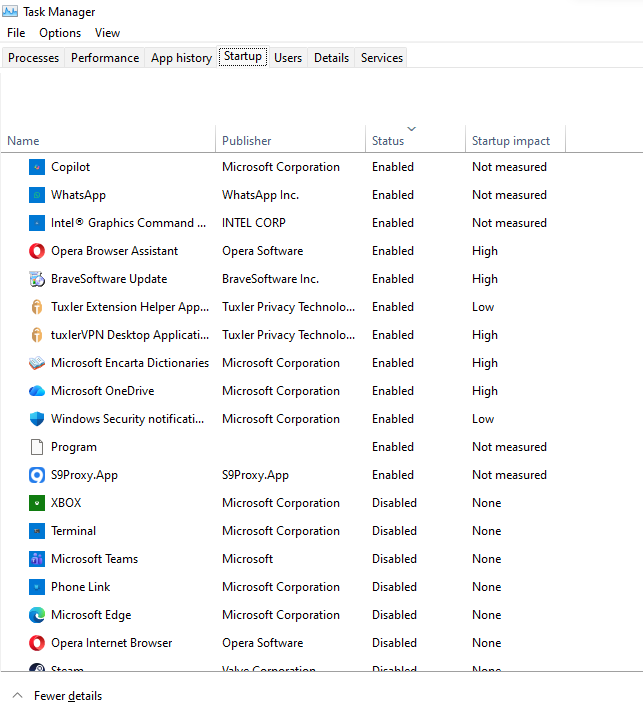
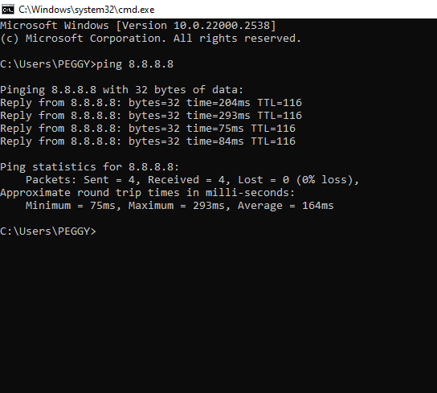

# IT Support Troubleshooting Guide

Short guides for common IT support problems, based on my hands-on support work and study. Each guide follows the same format: the symptom, the steps in the order I would try them, and when to escalate.

## Contents

1. [Printer not working](#1-printer-not-working)
2. [Slow or non-starting computer](#2-slow-or-non-starting-computer)
3. [Network issues or no internet](#3-network-issues-or-no-internet)

---

## 1. Printer not working

**Symptom:** A user sends a document to print and nothing comes out, or the job stays in the queue.

**Steps:**

1. **Check power and physical connections.** Make sure the printer is on and that the power and USB or network cables are plugged in properly.
2. **Check connectivity.** For a network printer, confirm the connection hasn't dropped. Print a test page from the printer if it has that option.
3. **Look for a paper jam.** This is a very common cause, so check the paper path and the paper tray, and look for error lights on the printer.
4. **Check the default printer.** Make sure the right printer is selected on the computer, not a different or old one.
5. **Clear the print queue** if jobs are stuck, then print a test page.

**Escalate when:** the printer shows a hardware error, it can't be reached even though the network is fine, or the driver needs admin rights to reinstall.

---

## 2. Slow or non-starting computer

### A. Computer won't start

**Symptom:** The computer doesn't power on, or it powers on but doesn't reach the desktop.

**Steps:**

1. **Check all physical connections.** Check the power cable and outlet (or the charger and battery on a laptop) and the monitor cable. Make sure the monitor itself is on.
2. **Listen when you press the power button.** Note any beeps, grinding or clicking, or whether the fans spin up at all. Beep patterns can point to memory or hardware faults.
3. **Watch the screen closely.** Is it completely black, showing the manufacturer logo, showing an error message or blue screen, or showing a colour or pattern? Each tells you a different thing.
4. **Disconnect extra devices.** Unplug USB drives and other peripherals, then try again.
5. **Restart the computer.**
6. **Boot into Safe Mode.** If it starts in Safe Mode, the problem is probably software, such as a driver or startup program. If it won't start even there, suspect hardware.

**Escalate when:** there is no power at all with a good cable and outlet, it beeps with a hardware error pattern, or it makes grinding or clicking sounds that suggest a failing drive.

### B. Computer is very slow

**Symptom:** The computer takes a long time to start, open programs or respond.

**Steps:**

1. **Restart the computer.** This clears memory and fixes many temporary slowdowns.
2. **Open Task Manager** (Ctrl + Shift + Esc) and check which resource is maxed out: CPU, memory or disk, and which program is using it.
3. **Close or end heavy programs,** including extra browser tabs.
4. **Reduce startup programs.** In Task Manager's Startup tab, disable apps that don't need to run at boot.
5. **Check free disk space.** A nearly full drive slows everything. Remove unused programs and files.
6. **Consider a hardware issue.** If memory is constantly almost full, it likely needs more RAM. If an older hard drive is constantly at 100%, an SSD upgrade is the usual fix.

**Escalate when:** the machine is still slow after these steps, or the fix needs a hardware upgrade.

---

## 3. Network issues or no internet

**Symptom:** A user can't get online, or the Wi-Fi shows "no internet".

**Steps:**

1. **Check all physical connections.** Make sure the network cable, router and switch are powered on and plugged in properly, with normal lights.
2. **Check whether it's one device or everyone.** If other devices connect fine, the problem is with this computer.
3. **Forget the Wi-Fi network (SSID) and reconnect.** Enter the password again.
4. **Ping to find where it breaks:**
   - Ping the router's IP address. If that fails, the problem is between the computer and the router.
   - Ping a public address such as `8.8.8.8`. If the router works but this fails, the problem is beyond the router, such as the provider.
   - Ping a website name such as `google.com`. If `8.8.8.8` works but the name fails, it is a DNS problem.
5. **Restart the computer, then the router.**
6. **If pages are slow but other apps work,** clear the browser history and cache.

**Escalate when:** the whole building or site is offline, the router won't power on or respond, or the problem is on the internet provider's side.

See also: [Network Ping Checker](https://github.com/boakye-eb/network-ping-checker)

---

## What I learned

Writing this guide taught me to troubleshoot in a fixed order instead of guessing, starting with the simple things like power and cables. Running ping showed me how to tell whether a problem is with the computer, the router or the internet provider, and Task Manager showed me what is slowing a computer down.
